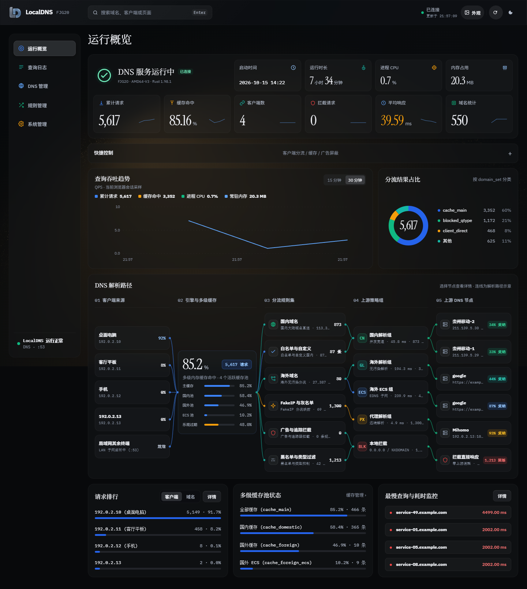
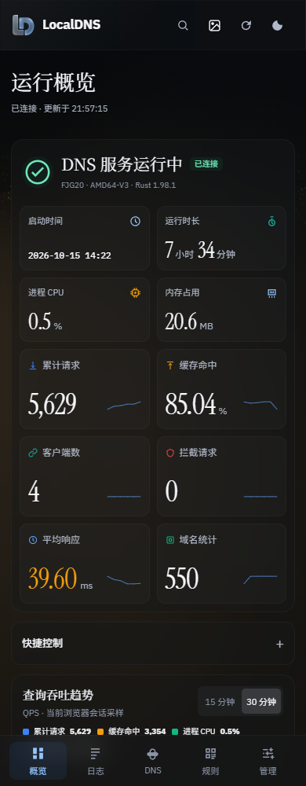

# LocalDNS


由 **Rust DNS 核心**与 **Web 管理界面**组成的 DNS 项目。

**DNS 核心主要由折腾日记交流群里的 R 大使用 Rust 编写；[yyhoworks](https://github.com/yyhoworks) 负责 UI 设计。**

当前版本：**后端 FJG20 / UI 2026.10.15.2**。

最新下载：**[UI 2026.10.15.2 Release](https://github.com/yyhoworks/LocalDNS/releases/tag/ui-v2026.10.15.2)**。

[安装说明](INSTALL.md) · [下载 Releases](https://github.com/yyhoworks/LocalDNS/releases) · [作者与分工](AUTHORS.md) · [开发说明](docs/DEVELOPMENT.md) · [近期更新](CHANGELOG.md)

## 作者与分工

| 作者 | 负责内容 |
|---|---|
| **R 大（折腾日记交流群）** | **DNS 核心，主要使用 Rust 编写** |
| **[yyhoworks](https://github.com/yyhoworks)** | **UI 设计** |

完整署名见 [AUTHORS.md](AUTHORS.md)。

## 界面预览



界面使用可调整透明度的玻璃材质、随滚动收拢的顶部导航、宋体标题与 Instrument Serif 衬线数字。字体随项目本地提供。

<details>
<summary>查看手机布局</summary>



</details>

## 可以做什么

- **运行概览**：查看服务状态、启动时间、运行时长、CPU、内存和六项 DNS 指标。
- **查询日志**：检索、筛选 DNS 请求，查看解析详情。
- **DNS 管理**：管理上游服务器，查看请求、采纳和错误统计。
- **规则管理**：维护分流与拦截名单，切换名单时保留未保存草稿。
- **系统管理**：管理缓存、功能开关与运行数据。
- **外观设置**：调整壁纸、模糊、透明度与背景暗化；支持深浅主题与手机布局。

壁纸与外观保存在当前浏览器。较大的本地图片使用 IndexedDB 保存；面板会提示保存结果，在线图片地址在刷新后自动回填。

查询趋势使用当前浏览器会话的真实采样，未附加服务器历史数据库。

## 快速安装

1. 在 [Releases](https://github.com/yyhoworks/LocalDNS/releases/tag/ui-v2026.10.15.2) 下载完整包或 UI 升级包，并核对同页的 `SHA256SUMS.txt`。
2. 已有 LocalDNS 服务时，解压 UI 升级包并运行：

   ```sh
   sh install-ui.sh /opt/localdns
   ```

3. 打开 `http://服务器地址:9099/ui/` 并刷新页面。

升级脚本保留现有 DNS 配置、规则和后端程序，并备份原有 UI。新安装、平台二进制选择与回退步骤见 [INSTALL.md](INSTALL.md)。

## 仓库结构

```text
_src/ui/              当前 Web 界面源码、本地字体与 Logo
tools/                UI 打包工具与更新脚本
docs/                 开发、验证与第三方说明
AUTHORS.md            作者署名与分工
INSTALL.md            安装、更新与回退
VERSION.json          UI 与后端版号
```

安装 ZIP 和后端预编译程序放在 Releases。部署凭据、设备配置、运行日志、临时截图和历史工作文件不进入 Git。

**当前仓库包含 UI 源码；当前工作目录未提供 Rust DNS 核心源码，DNS 核心通过 FJG20 预编译发行包提供。**

## 开发与打包

需要 Python 3.10+：

```sh
python tools/package_ui.py
```

生成的 UI 升级包和 SHA-256 校验文件位于 `dist/`。本工具只构建 Web 界面，不编译 Rust 核心。详见 [开发说明](docs/DEVELOPMENT.md)。

## 来源与许可

项目作者与职责以 [AUTHORS.md](AUTHORS.md) 为准。仓库暂未指定覆盖全部项目代码的统一开源许可证。

字体、Chart.js 等第三方组件遵循各自许可，见 [THIRD_PARTY_NOTICES.md](THIRD_PARTY_NOTICES.md)。

