# LocalDNS


一个由 **Rust DNS 核心**与 **玻璃质感 Web 控制台**组成的本地 DNS 项目。集中查看解析状态、排查查询、管理上游与分流规则，让日常 DNS 管理更直观。

**DNS 核心主要由折腾日记交流群里的 R 大使用 Rust 编写；[yyhoworks](https://github.com/yyhoworks) 负责 UI 设计。**

当前版本：**[后端 FJGAC / UI 2026.10.18.19](https://github.com/yyhoworks/LocalDNS/releases/tag/fjgac-ui-v2026.10.18.19)**，提供完整包、UI 升级包、配置服务包和 SHA-256 校验文件，见 [本次更新说明](docs/releases/fjgac-ui-v2026.10.18.19.md)。

本次增加可视化名单编辑与服务器备份，并保留紧凑的代理面板入口和本机配置编辑器。用户可选择配置文件、查看修改差异并执行核心校验，保存时自动备份与重载，失败时恢复原配置。进入编辑器直接读取本机配置，无需 SSH 登录。内核继续使用 FJGAC，保留双皮肤、卡片 / 列表排列、横向 / 纵向导航、客户端管理和单张壁纸设置。

[产品图集](docs/SCREENSHOTS.md) · [功能指南](docs/FEATURES.md) · [安装说明](INSTALL.md) · [下载 Releases](https://github.com/yyhoworks/LocalDNS/releases) · [作者与分工](AUTHORS.md) · [开发说明](docs/DEVELOPMENT.md) · [近期更新](CHANGELOG.md)

本版合入 clone-fan 的 [PR #3](https://github.com/yyhoworks/LocalDNS/pull/3)，增加两款皮肤共用的「清单工作台」、列表 / 原文切换与服务器名单备份；同时收录 sing-box 分片支持、7 天服务器采样及共享名称 / Logo。

## 代理面板与本机配置编辑

顶栏使用所选核心的 Logo，点击打开自定义面板地址。在「系统管理 → 编辑配置」中管理与 LocalDNS 同机的 Mihomo YAML / sing-box JSON，支持查找、折叠、修改对比、原生校验、备份和重载。

配置编辑、名单保存备份、共享名称 / Logo 与服务器采样需要安装或升级 Release 附带的 `LocalDNS_ProxyConfig_UI_2026.10.18.19_Service.zip`。UI 升级包只更新界面；独立服务自动选择 Linux amd64 / arm64，支持 OpenRC / systemd。详情见 [安装说明](INSTALL.md) 与 [服务说明](services/proxy-config/README.md)。文件操作限制在管理员指定的目录；保存并重载针对当前启动配置。

## 作者与分工

| 作者 | 负责内容 |
|---|---|
| **R 大（折腾日记交流群）** | **DNS 核心，主要使用 Rust 编写** |
| **[yyhoworks](https://github.com/yyhoworks)** | **UI 设计** |
| **[clone-fan](https://github.com/clone-fan)** | **社区 UI 贡献：玻璃视觉、动效、字体上传与可视化名单编辑（[PR #1](https://github.com/yyhoworks/LocalDNS/pull/1)、[PR #3](https://github.com/yyhoworks/LocalDNS/pull/3)）** |

感谢 @clone-fan 的 [PR #1](https://github.com/yyhoworks/LocalDNS/pull/1) 与 [PR #3](https://github.com/yyhoworks/LocalDNS/pull/3)。正式版保留贡献者的原始提交历史，完整署名见 [AUTHORS.md](AUTHORS.md)。

## 界面预览

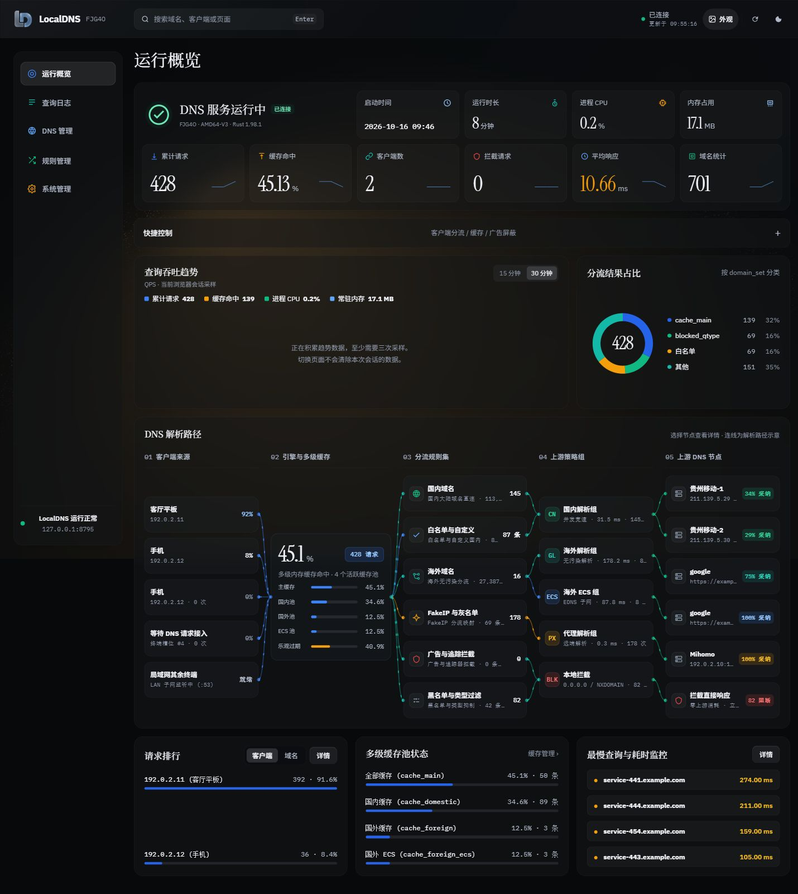

**集中查看 DNS 运行情况。** 服务状态与六项关键指标、查询吞吐趋势、分流占比、解析路径、请求排行和多级缓存状态集中展示。解析路径节点可点击查看详情，连线用于说明解析关系。

「外观 → 导航布局」可切换垂直侧栏与居中水平导航；垂直侧栏可折叠，手机保留底部导航。双皮肤、字体与壁纸设置独立保留。界面采用可调整透明度与模糊度的玻璃材质，搭配随滚动收拢的浮动顶部导航、Noto Serif SC 宋体风格标题与 Instrument Serif 衬线数字。字体随项目本地提供，可在「外观 → 字体与阅读」分别选择标题、数字与正文的字体。

> 以下截图保留作历史界面参考，具体版本见 [产品图集](docs/SCREENSHOTS.md)。当前版本保留五列解析拓扑与可关闭的流光示意，并增加分支 / 节点锁定；单次请求详情仅组织该请求实际记录的字段。域名、客户端、订阅地址等使用脱敏或示例数据；图中数值不代表性能测试结果。

### 深浅主题与外观定制

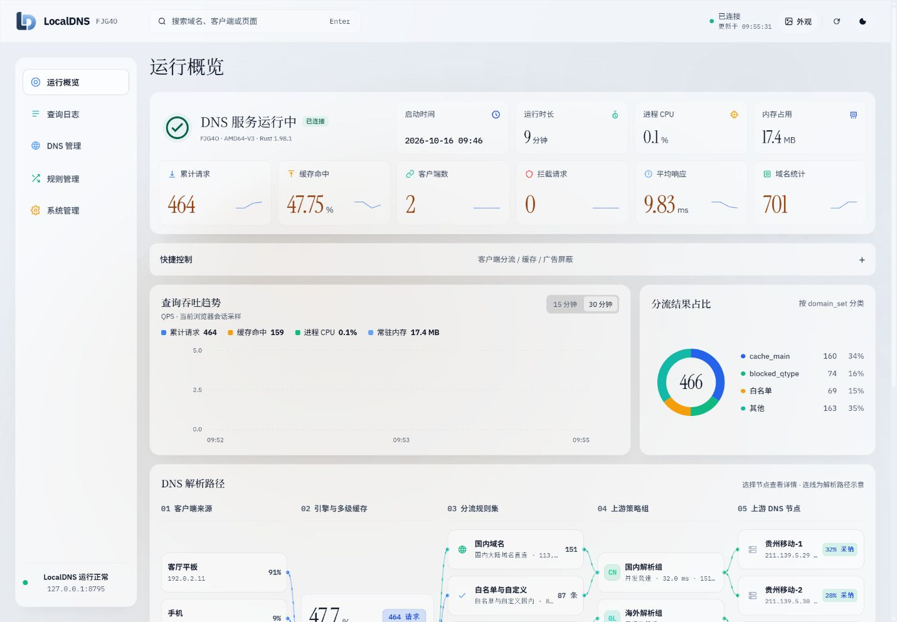

深浅主题一键切换，Logo 随主题适配。五组预设光影、本地壁纸和在线图片地址可自由选择；模糊度、面板遮盖度与背景暗化独立调整。

<details>
<summary>查看外观设置面板</summary>

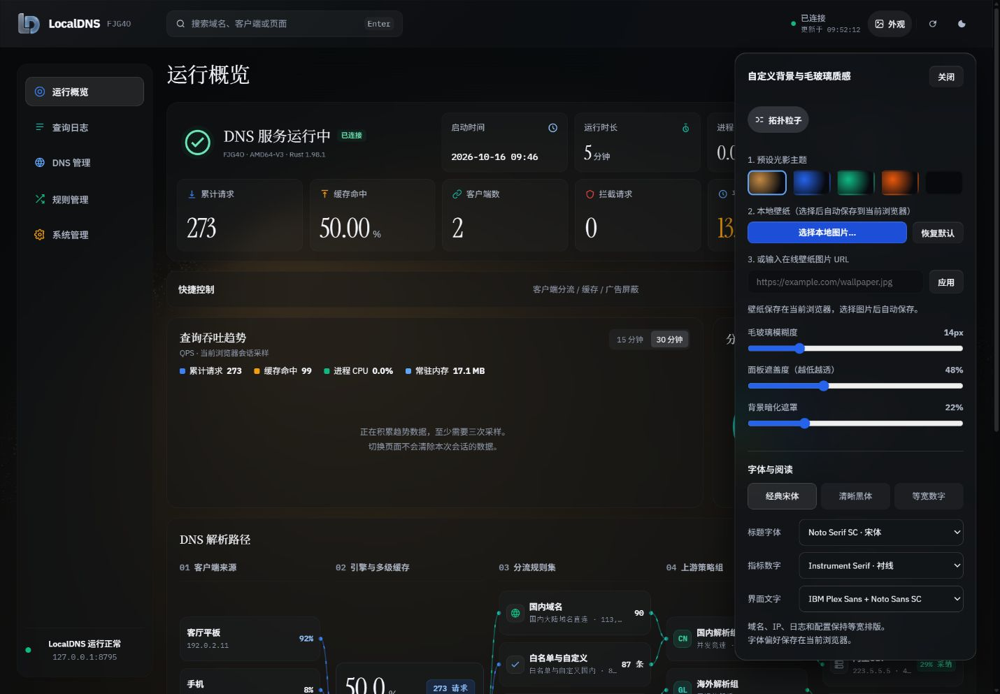

选择本地图片后自动保存；在线地址点击「应用」保存。面板显示保存结果，刷新后恢复当前浏览器的外观偏好。

</details>

### 字体与阅读

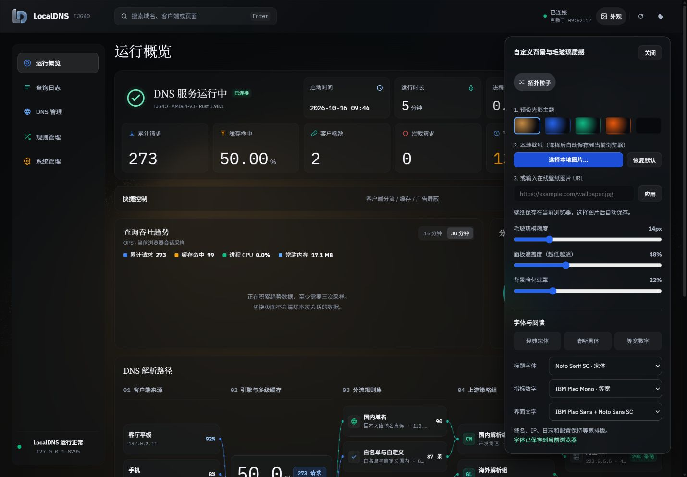

可分别选择标题、指标数字和界面文字的字体。支持上传合法取得的 TTF / OTF / WOFF / WOFF2 字体并分别分配用途；文件和偏好只保存在当前浏览器，不上传服务器。域名、IP 与日志继续使用等宽字体。

### 日志、上游与规则管理

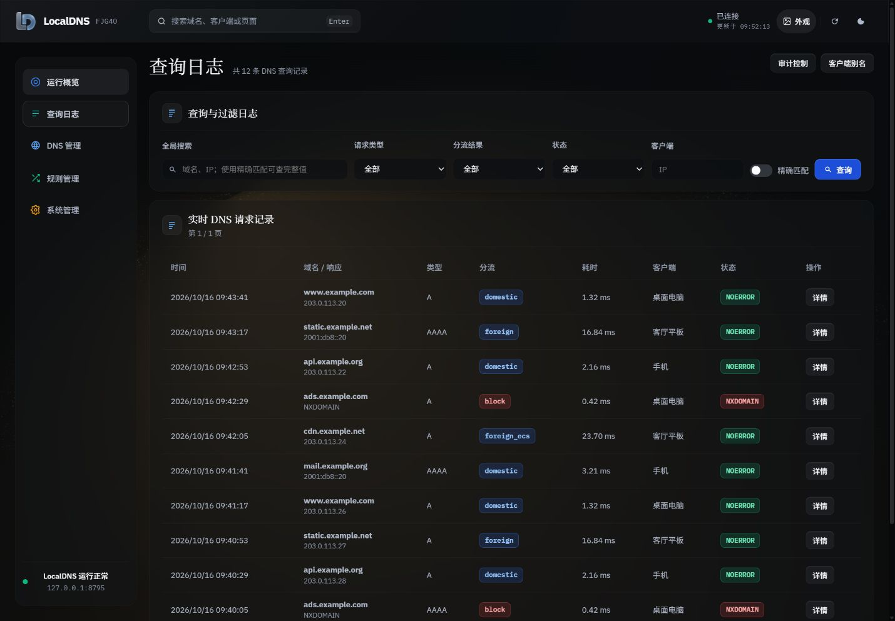

按域名、客户端、请求类型、分流结果和响应码筛选，点击「详情」查看完整查询与响应记录。

<details>
<summary>查看查询详情、DNS 上游、规则订阅与系统管理</summary>

**查询详情** · 抽屉展示请求来源、缓存记录、最终分流与应答的路径摘要，并保留原始日志。后端未记录的规则、上游、阶段耗时和应答元数据保持未知。

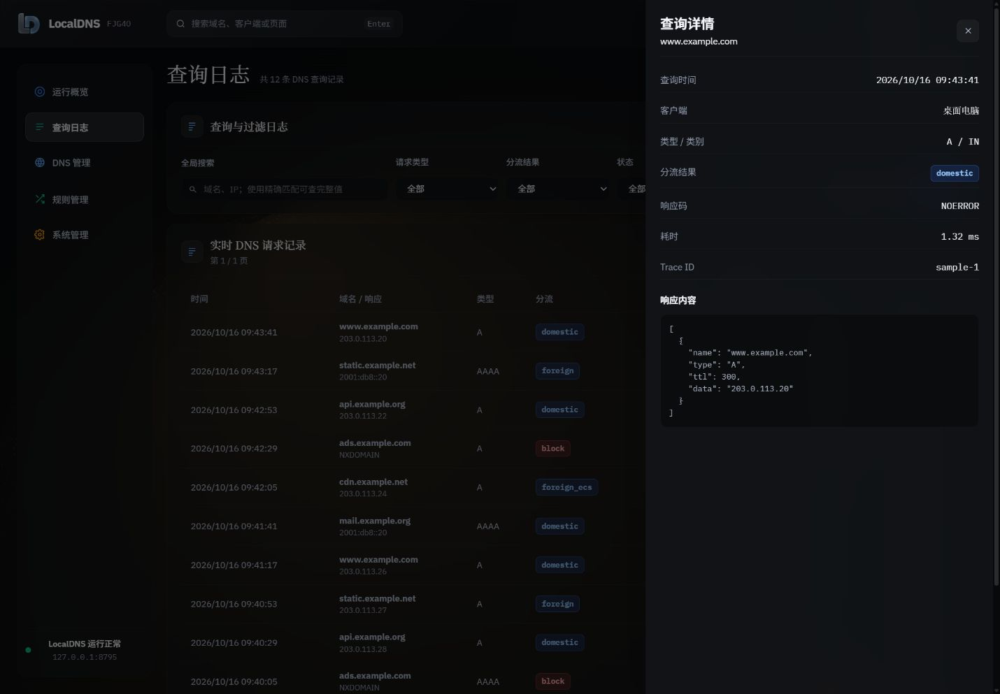

**DNS 管理** · 查看各组上游的协议、地址、平均响应、请求数、并发采纳数、错误数与成功率。

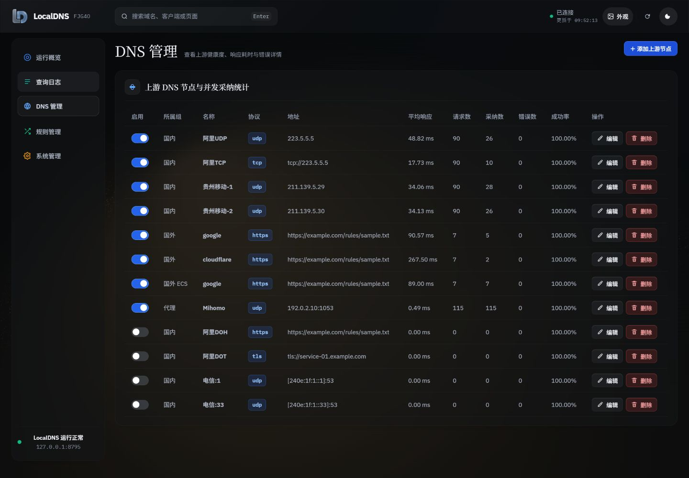

**名单管理** · 编辑本地名单、下载列表，并在切换名单时保留未保存草稿。

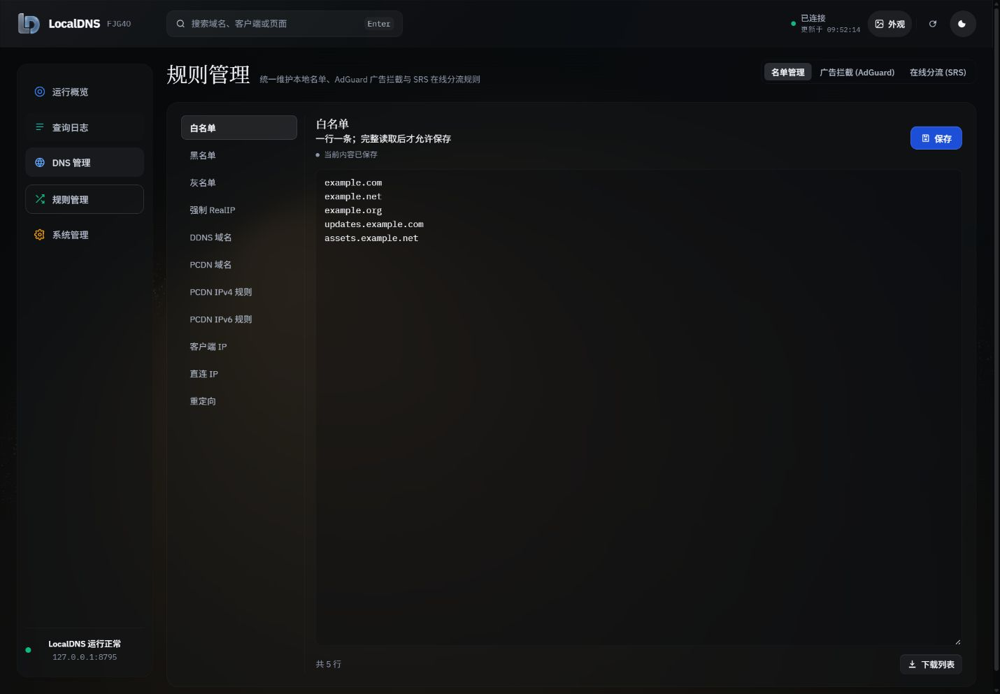

**广告拦截** · 管理 AdGuard 规则订阅、更新间隔与自动更新状态。

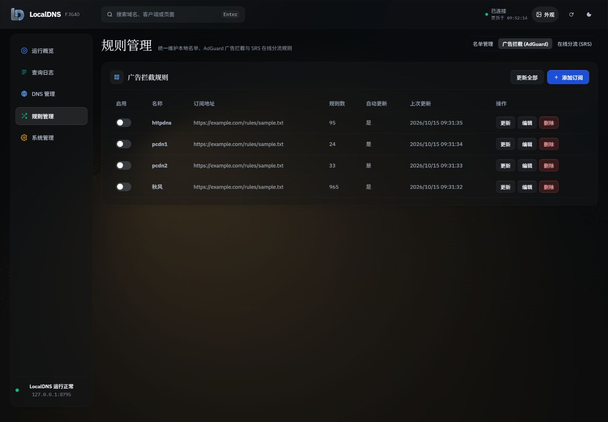

**在线分流** · 管理国内、国外、GeoIP 与 Geosite 来源，查看识别格式与规则数量。

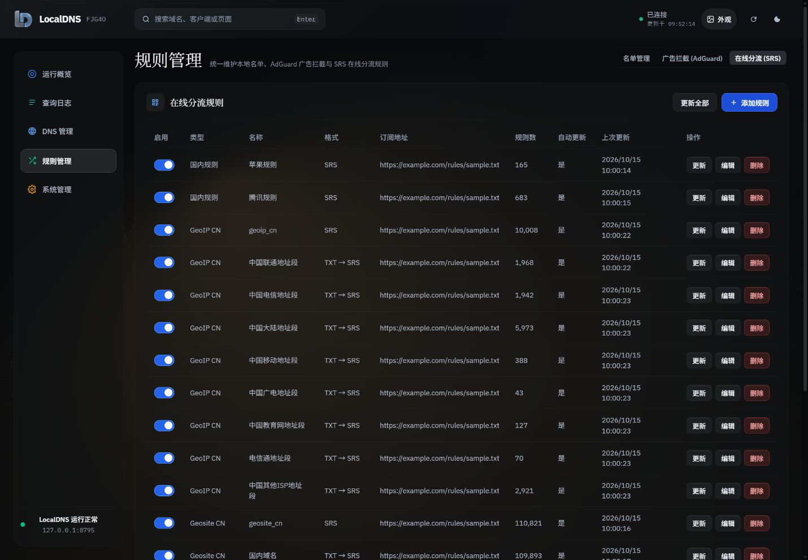

**系统管理** · 集中管理缓存、功能开关、域名统计与分流刷新任务。

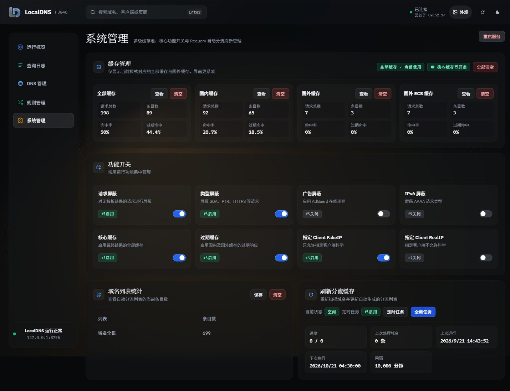

</details>

### 手机也能管理

窄屏使用底部导航，查询日志和上游表格转换为便于阅读的记录卡片，名单编辑提供类别选择器。

<details>
<summary>查看手机概览与查询日志</summary>

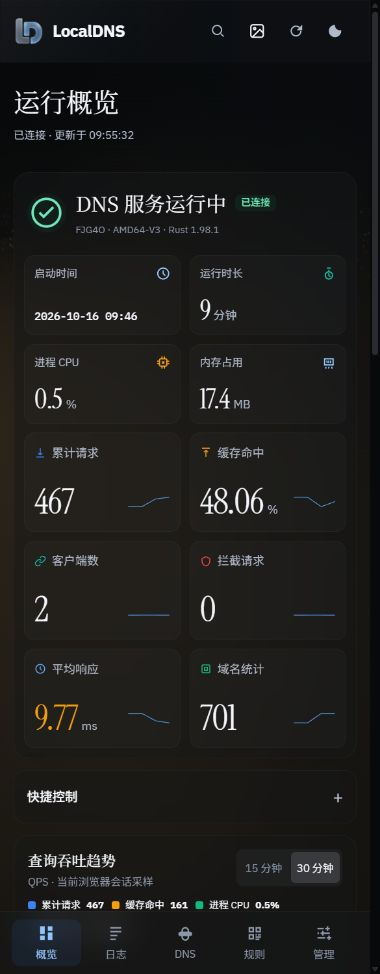 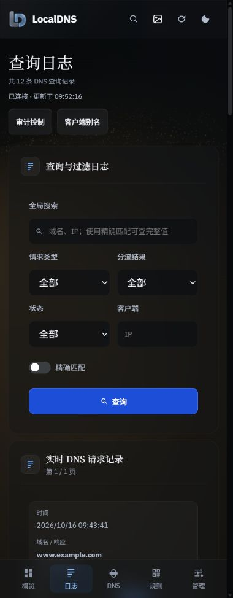

</details>

全部 13 张截图及页面说明见 **[产品图集](docs/SCREENSHOTS.md)**。

## 可以做什么

| 模块 | 主要能力 |
|---|---|
| **运行概览** | 服务在线状态、启动时间、运行时长、进程 CPU 与内存；累计请求、缓存命中、客户端数、拦截请求、平均响应、域名统计；QPS 趋势、分流占比、解析路径与排行 |
| **查询日志** | 域名与 IP 搜索、精确匹配、多条件筛选、分页、响应详情；审计开关、日志容量、清空日志与客户端别名 |
| **DNS 管理** | 国内、国外、国外 ECS、代理四组上游；UDP / TCP / TLS / HTTPS；新增、编辑、启停、删除；响应耗时、采纳数与错误详情 |
| **本地名单** | 白名单、黑名单、灰名单、强制 RealIP、DDNS、PCDN、客户端 IP、直连 IP 与重定向；列表下载与切换时保留草稿 |
| **广告拦截** | AdGuard 规则订阅；启停、编辑、单独更新、批量更新、自动更新与更新间隔；规则数与上次更新时间 |
| **在线分流** | 国内 / 国外自定义规则、GeoIP CN、Geosite CN / 非 CN；来源格式识别并转换为 SRS；同组来源合并去重 |
| **系统管理** | 四类缓存池的查看与清空；请求、类型、广告、IPv6、核心缓存、过期缓存及客户端分流开关；域名列表统计与 Requery 定时刷新 |
| **外观与交互** | 深浅主题、五组光影预设、本地 / 在线壁纸、玻璃参数、滚动浮动导航、顶部搜索、键盘操作与手机布局 |

详细操作、协议与规则格式说明见 **[功能指南](docs/FEATURES.md)**。后端相关能力需要配套的 FJG4Z 服务与对应插件。

两行侧栏状态文字分别居中；输入与导航使用柔白细边，键盘操作保留清楚的单层焦点提示。

壁纸、字体与外观保存在当前浏览器，不会同步到其他设备。较大的本地图片使用 IndexedDB 保存；面板会提示保存结果，在线图片地址在刷新后自动回填。

查询趋势使用当前浏览器会话的真实采样，提供 15 / 30 分钟视图；至少积累三次采样后绘图，最多保留 240 个采样点、最长两小时，不作为服务器历史报表。

## 快速安装

1. 在 [Releases](https://github.com/yyhoworks/LocalDNS/releases/tag/fjgac-ui-v2026.10.18.19) 下载完整包或 UI 升级包，并核对同页的 `SHA256SUMS.txt`。**升级 FJGAC 内核必须从完整包选择对应架构的程序；UI 升级包不含内核。**
2. 已有 LocalDNS 服务时，解压 UI 升级包并运行：

   ```sh
   sh install-ui.sh /opt/localdns
   ```

3. 打开 `http://服务器地址:9099/ui/` 并刷新页面。

升级脚本保留现有 DNS 配置、规则和后端程序，并备份原有 UI。新安装、平台二进制选择与回退步骤见 [INSTALL.md](INSTALL.md)。

## 仓库结构

```text
_src/ui/              当前 Web 界面源码、本地字体与 Logo
tools/                UI / 服务打包、验证与更新脚本
services/proxy-config/ 本机代理配置管理服务与安装器
docs/                 开发、验证与第三方说明
AUTHORS.md            作者署名与分工
INSTALL.md            安装、更新与回退
VERSION.json          UI 与后端版号
```

安装 ZIP 和后端预编译程序放在 Releases。部署凭据、设备配置、运行日志、临时截图和历史工作文件不进入 Git。

**当前仓库包含 UI 源码；当前工作目录未提供 Rust DNS 核心源码，DNS 核心通过 FJGAC 预编译发行包提供。**

## 开发与打包

需要 Python 3.10+：

```sh
python tools/package_ui.py
```

生成的 UI 升级包和 SHA-256 校验文件位于 `dist/`。本工具只构建 Web 界面，不编译 Rust 核心。详见 [开发说明](docs/DEVELOPMENT.md)。

## 来源与许可

顶部导航栏的玻璃质感、随滚动收拢为圆角浮动栏的设计借鉴了 [MoviePilot](https://github.com/jxxghp/MoviePilot)，感谢其项目团队的设计启发。

项目作者与职责以 [AUTHORS.md](AUTHORS.md) 为准。仓库暂未指定覆盖全部项目代码的统一开源许可证。

字体、Chart.js 等第三方组件遵循各自许可，见 [THIRD_PARTY_NOTICES.md](THIRD_PARTY_NOTICES.md)。

